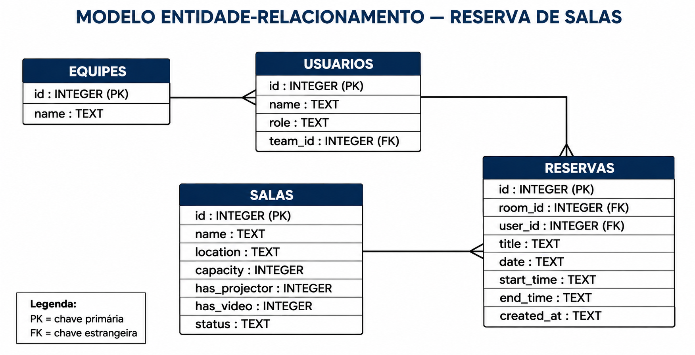

# Protótipo de reserva de salas
Aplicativo usa Javascript do backend (Express) e no front end e banco de dados SQlite.

<video width="320" height="240" controls>
  <source src="demo.mov" type="video/mp4">
</video>


### Modelo entidade relacionamento



### Executar

   ```bash
   npm install
   npm start

   ```
App disponível na port 3000

### Autores
- Oracio Carvalho Schopping
- Lara Ferreira Gonçalves
- João Pedro Teixeira Amouzou
- André Zicatti Leite
- Guilherme dos Santos Bueno
- Daniel Gonçalves Souza
- Gustavo Henrique Rodrigues Pinto da Mota
